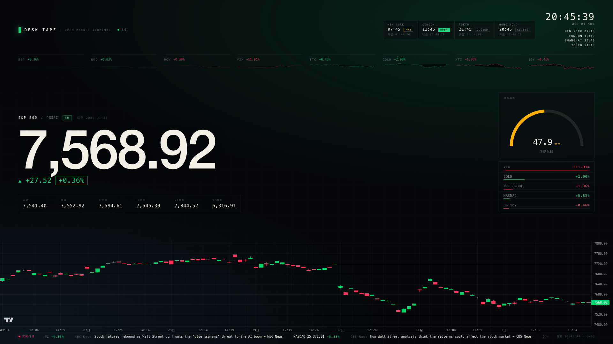
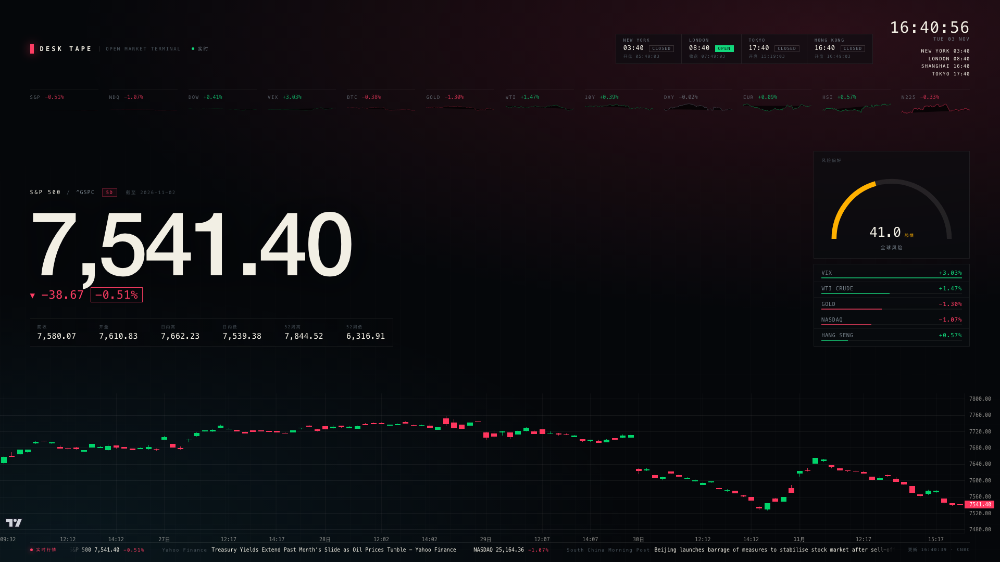
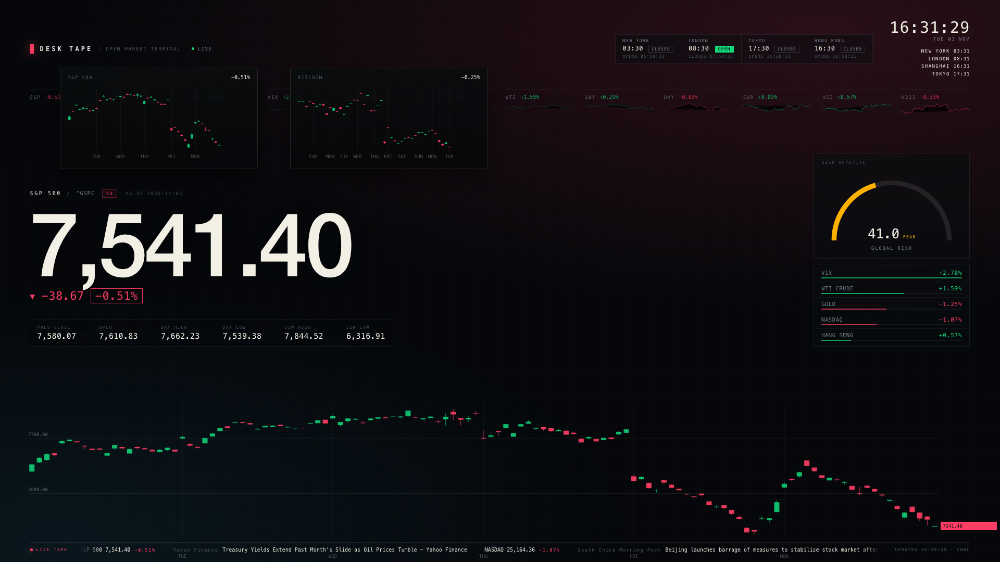
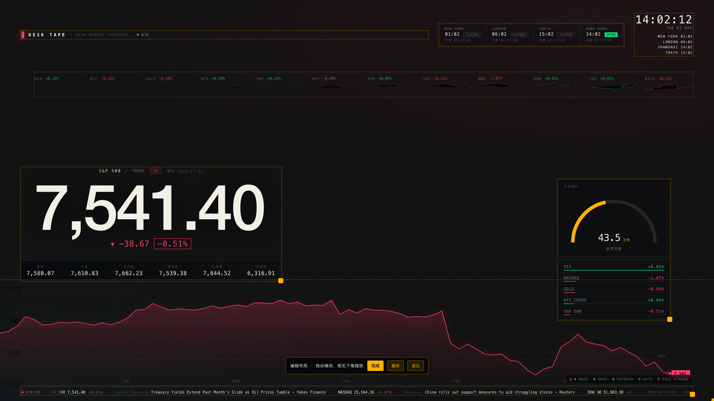

# Desk Tape

A live market wallpaper for macOS: quotes, intraday charts, world-session clocks and a
risk gauge drawn *behind* your desktop icons, with draggable modules and add/remove
widgets.



## What it is

- **A wallpaper layer, not a window.** A PyObjC host pins a WKWebView at window level
  `-2147483610` (between the system wallpaper and the Finder desktop), so icons and
  desktop widgets stay in front and clicks keep working on the desktop.
- **A menu-bar app.** Click the chart icon for the settings panel: language, world
  clocks, padding, chart style (TradingView / native candles / line), blocks, widgets.
- **Real, keyless market data.** CNBC's public quote and chart services are the primary
  feed (12 symbols), Yahoo is a fallback only. Nothing is invented: a symbol without
  data comes back as an honest two-point flat line.
- **Customisable like desktop widgets.** Drag modules anywhere (snapped to 1 %), resize
  them, add or remove widgets from the edit bar *or* the settings panel; the layout is
  stored in `~/Library/Application Support/DeskTape/settings.json`.

| TradingView chart | Native candles | Dragging modules |
| --- | --- | --- |
|  |  |  |

## Quick start

Requirements: macOS 11+, `python3.12` with PyObjC (`pip install pyobjc-framework-Cocoa`).

```sh
./scripts/start.sh                 # start the local data server and open the app
./scripts/install-wallpaper-app.sh # install ~/Applications/DeskTape.app + Desktop launcher
./scripts/wallpaper_status.py      # prove it is running under the Finder desktop
```

Then look at your desktop; the menu-bar icon opens the panel. Left/right click on the
wallpaper does nothing by design — it is click-through so your desktop stays usable.

## Paper-only browser view

The same page runs in any browser for layout work:

```sh
python3.12 desk_tape_server.py                 # http://127.0.0.1:8787/wallpaper
```

URL parameters: `mode=horizon|board|focus|minimal`, `hero=^GSPC`, `symbols=^GSPC,^VIX`,
`lang=zh|en`, `chart=tv|candles|line`, `refresh=30`, `hud=1`, `edit=1`, `widgets=[…]`.

Keyboard: `1`–`4` modes, `H` cycle hero, `R` refresh, `K` cycle chart style, `L` edit
layout, `F` fullscreen.

## Editing the layout

Press `L` (or use the panel's checkbox) to enter edit mode: the wallpaper window rises
above the Finder desktop so you can drag with a real mouse; the page turns
transparent so icons stay visible. Drag any module, resize from the lower-right handle,
add widgets with `＋组件`, remove them with `×`. `完成` saves and exits; edit mode also
exits by itself after 150 s so the desktop never stays click-blocked.

## Data sources

| Feed | Endpoint | Used for |
| --- | --- | --- |
| CNBC quotes | `quote.cnbc.com/…/restQuote` | price, change, OHLC, year range, market status |
| CNBC charts | `ts-api.cnbc.com/harmony/app/charts/{5D,1D}.json` | 5-day intraday series and candles |
| Yahoo Finance | `query1.finance.yahoo.com` | fallback only, when CNBC has no row |
| Google News RSS | `news.google.com/rss/search` | the headline tape |

Everything is fetched server-side by `desk_tape_server.py` with short caches (quotes
20 s, series 10 min, payload 30 s, candles 5 min), so the page never talks to a third
party directly and never needs an API key.

## Security notes

- The host only loads `http(s)` URLs on loopback unless `DESKTAPE_ALLOW_REMOTE_URL=1` is
  set: a config-supplied page must never inherit the native settings bridge.
- `~/Library/Logs/DeskTape.log` is opened with `O_NOFOLLOW` and mode `0600`.
- The settings file and its directory are `0600`/`0700`; the LaunchAgent plist is `0600`.
- The local server binds `127.0.0.1` only and is a read-only data source.

## Repository layout

```
desk_tape_server.py     local data + page server (stdlib only)
wallpaper_data.py       CNBC/Yahoo/RSS parsing, sessions, payload assembly
public/                 the wallpaper page (no build step)
desktop/desk_tape.py    macOS host: wallpaper windows, menu bar, settings panel
scripts/                build, install, status, feed check, reset
tests/                  data-layer tests (python3.12 -m unittest discover -s tests)
```

## Tests

```sh
python3.12 -m unittest discover -s tests -p "test_*.py"
python3.12 scripts/check_feeds.py            # live data, needs the server running
```

## Licence

MIT. TradingView Lightweight Charts™ is vendored under `public/vendor/` under its own
Apache-2.0 licence with the required attribution notice.
